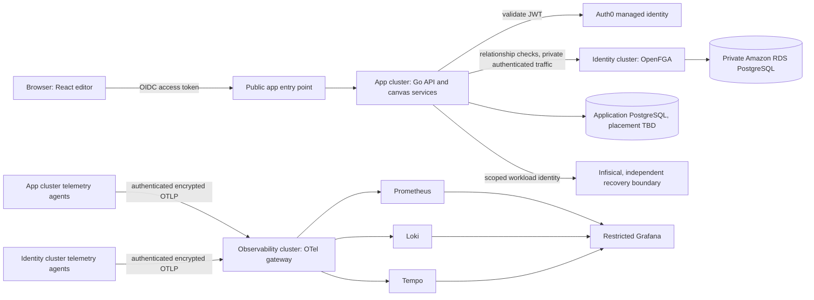

# System boundaries and repository layout

**Status:** Proposed foundation, not deployed.

**Initial AWS region:** `ap-south-1` (Mumbai).

## Runtime boundaries

The initial platform has three independent EKS control planes in one AWS region:

| Cluster | Owns | Main boundary |
| --- | --- | --- |
| `kloudlab-app` | Frontend, API, application workloads, kgateway and application telemetry agents | Public application entry point; private calls to OpenFGA and telemetry gateway |
| `kloudlab-identity` | OpenFGA, identity support workloads and telemetry agents | Private authorization endpoint and durable PostgreSQL datastore |
| `kloudlab-observability` | Central OpenTelemetry gateway, Prometheus, Loki, Tempo and Grafana | Restricted operational access and durable telemetry storage |

Auth0 is external and is not deployed in Kubernetes. Each cluster has a dedicated VPC as a starting point. Cluster separation creates lifecycle and security boundaries, but three clusters in one region do not provide regional disaster recovery.

The public request path is DNS → AWS load balancer → kgateway/Gateway API → application service → backend token validation and authorization. Only intended application entry points are public. Database, OpenFGA administration, telemetry backends, and Grafana remain private or tightly restricted.

## Repository structure

The canonical target tree and migration rules are maintained in [repository-structure.md](repository-structure.md). The tree is a target layout, not a claim that planned applications, stacks, or cluster configuration already exist.

## Phase 2 network foundation

The `infra/components/network` package implements VPCs, subnet allocation,
explicit routing, NAT profiles, an S3 gateway endpoint, direct VPC peering,
and reusable security-group rule resources. Separate Pulumi projects own the
three networks, connectivity, S3/KMS state bootstrap, and GitHub OIDC role.
They are implemented but not deployed. Proposed CIDRs and AWS access settings
remain account-level checks before preview or provisioning.

## Initial component model

The Pulumi module defines deployable network, state-backend, and GitHub OIDC components alongside typed contracts for EKS, database, DNS, secrets integration, and observability infrastructure. Those remaining contracts do not register resources or contain provider-specific deployment logic yet.

`infra/config/` supplies the initial shared naming, region/environment validation, and standard resource tags. It does not contain account credentials or environment-specific secrets.

Future canvas components are a separate product model. Each canvas catalog entry will have a stable type ID, display metadata, versioned JSON configuration schema, typed input/output connection kinds, validation, documentation references, and an optional implementation mapping. Canvas inputs remain untrusted; only a validated plan may proceed to a preview and separately authorized deployment flow.

The initial catalog candidates are EKS, Kubernetes workloads, gateways, databases, Auth0, OpenFGA, OpenTelemetry, Prometheus, Loki, Tempo, Grafana, and secrets management. The versioned [canvas document schema](canvas-v1.schema.json) and [catalog component schema](catalog-component-v1.schema.json) define the stored shape. Backend validation must also enforce unique IDs, valid edge endpoints, compatible output/input ports, and each component's configuration schema. Validation rule IDs map to trusted backend validators; catalog data never supplies executable code.

## Ownership split

- **Pulumi Go:** AWS networking, EKS, foundational IAM, databases, DNS/certificates, and infrastructure prerequisites.
- **Argo CD:** ongoing Kubernetes applications and Helm releases, including kgateway, OpenFGA, Infisical integrations, OTel collectors, and application workloads.
- **Auth0:** user authentication and token issuance.
- **OpenFGA:** relationship-based application authorization, checked by the backend on every protected action.
- **Infisical:** secrets distribution and audit policy, subject to an independent recovery design.

The same live Kubernetes object must not be owned by both Pulumi and Argo CD.
